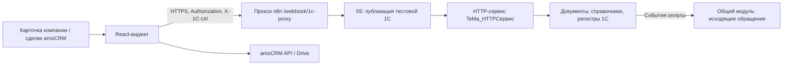

# Устройство проекта

## Поток данных

Прокси n8n — внешняя зависимость. Экспорт workflow и конфигурация сервера n8n в репозитории отсутствуют. При переносе их нужно получить отдельно или реализовать совместимый прокси. `backend/main.py` содержит только ответ-заглушку `POST /api/v1/documents/create`; интеграция с 1С в нём не реализована, `requirements.txt` пуст.

## Виджет

`frontend/src/main.jsx` читает настройки и монтирует компоненты в карточках и расширенных настройках. `OneCIntegrationButton.jsx` управляет документами сделки, товарами, ценами, НДС и PDF. `OneCCompanyButton.jsx` работает с контрагентом, подписантами и договорами компании. `AdvancedSettings.jsx` проверяет связь и отображает настройки подключения.

`frontend/widget/script.js` — AMD-оболочка amoCRM. Vite собирает React в IIFE `widget/app.js`; `manifest.json`, `i18n` и `images` составляют устанавливаемый пакет. Версия виджета берётся из `widget/manifest.json` (1.0.191), а не из `package.json` (1.0.0).

Кроме запросов через прокси код использует API amoCRM и Drive для прикрепления файлов. Адрес уведомления о выставленном счёте задан отдельно в `OneCIntegrationButton.jsx` и не меняется автоматически вместе с `n8n_url`.

## Расширение

Канонический исходник нового варианта: `1c-test-base/extension/price-contract-fix/src`. Это выгрузка расширения, а не исходники всей типовой конфигурации 1С.

| Объект | Роль |
| --- | --- |
| `HTTPServices/TeMa_HTTPСервис.xml` и `Ext/Module.bsl` | Маршруты, обработка запросов, создание документов, PDF |
| `CommonModules/TeMa_СобытияСервера/Ext/Module.bsl` | События обмена, общий выбор договора, перенос суммы с НДС |
| `Documents/СчетНаОплатуПокупателю/Ext/ObjectModule.bsl` | Дозаполнение счёта на основании заказа |
| `Documents/TeMa_ЗаказПокупателя.xml` | Метаданные заказа, включая составной тип договора |
| `CommonModules/МойМодульПечати` | Работа с печатными формами |
| `Documents/ПоступлениеНаРасчетныйСчет` | События платежей |
| Регистры `TeMa_ИдентификаторыAmoCRM_*` | Связи amoCRM ↔ объекты 1С и версии |
| `TeMa_ЛогиAPI` | Диагностика запросов и ответов |

Идентификаторы объектов 1С передаются как UUID. `amo_id` относится к компании или сделке в зависимости от маршрута. Подменять UUID объекта идентификатором amoCRM нельзя.
